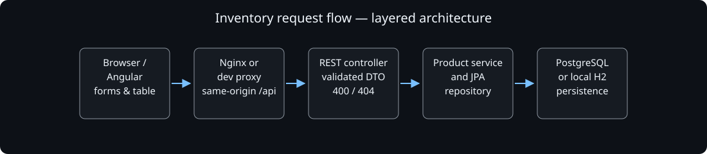
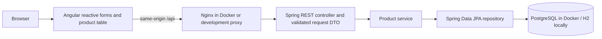
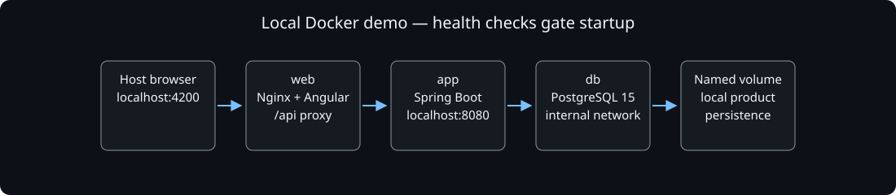
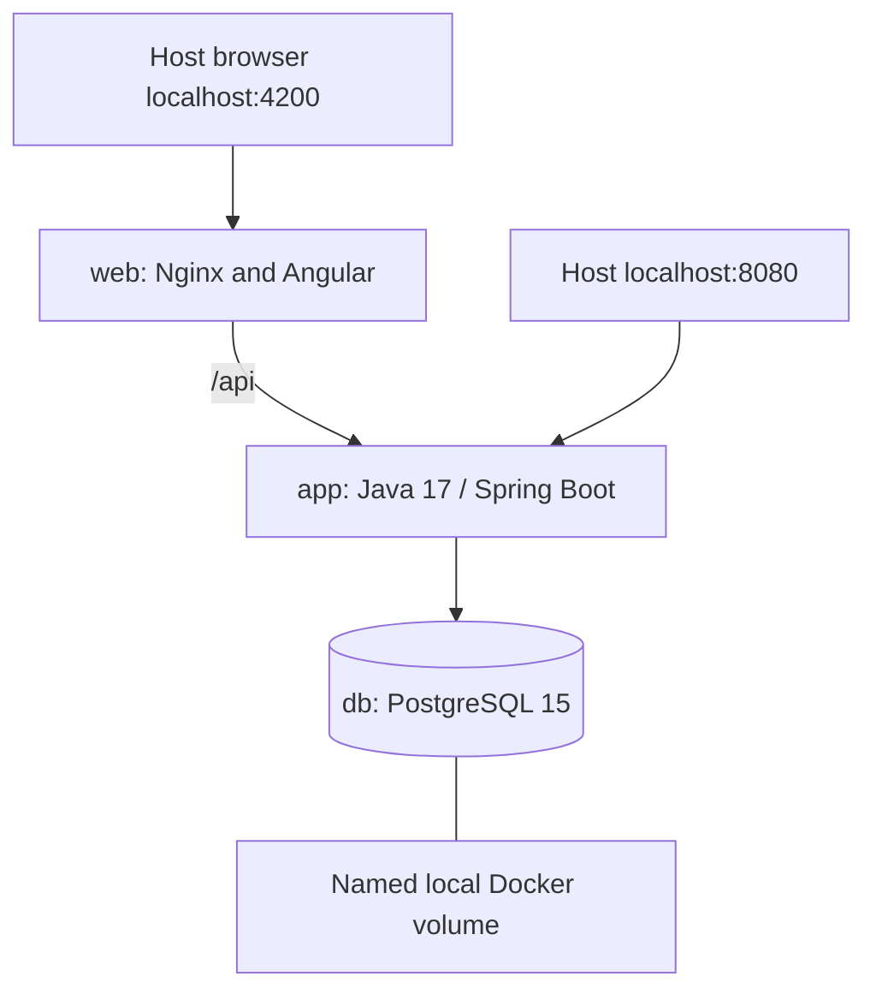

# Inventory architecture

This is a layered application. The separate [hexagonal labs](https://github.com/dan1el64/hexagonal-architecture-labs) demonstrate ports and adapters.

Editable Mermaid source

## Request and failure boundaries

1. The browser validates required fields, positive price and integer nonnegative stock for immediate feedback. The API independently validates every request.
2. Nginx forwards `/api/` to `app:8080`; the development proxy forwards it to localhost:8080. No database is reachable from browser code.
3. The controller maps validated fields to the product model; IDs are assigned by the server during creation. The service and repository perform the operation.
4. The API wraps results as `{success, message, data}`. Invalid input and malformed JSON return 400; missing products return 404.
5. The interface keeps form input after a failed save, prevents duplicate submissions and offers retry after a failed list request.

## Local deployment

Editable Mermaid source

The database health check precedes API startup; API health precedes web startup. Published ports bind to loopback. `scripts/demo.sh` in the backend repository composes all three services and clones the frontend sibling if missing.

## Decisions and limits

- One origin avoids embedding environment-specific backend URLs in the Angular bundle.
- A request DTO separates client input from the persistence entity. Browser validation improves UX; server validation protects writes.
- H2 provides a quick disposable development path. The complete CI demo uses actual PostgreSQL and checks the UI and proxied API over HTTP.
- Schema auto-update is suitable for this demo, not a migration strategy. Authentication, authorization, audit history and production deployment are outside scope.
- Layers describe this implementation accurately. It does not claim a framework-independent hexagonal domain.

[Read the case study](https://www.dan1el64.com/portafolio#inventario).
